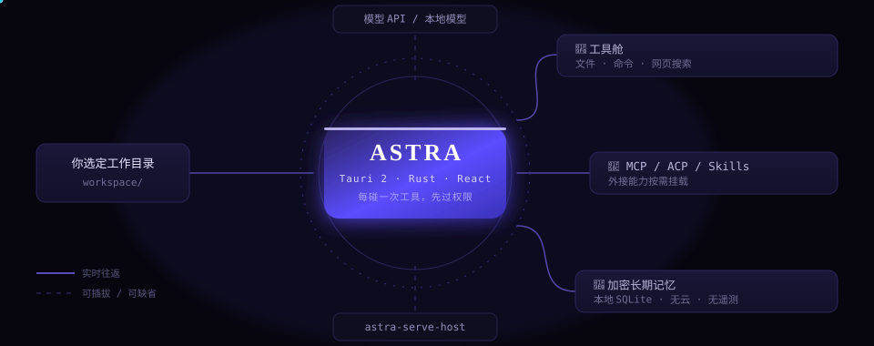

**local-first AI Agent 桌面应用** —— 选一个工作目录，用对话让它读文件、改文件、跑命令、搜网页、写文档、出图。
会话多开几扇标签；每次伸手碰工具，都先过权限引擎；记得住的东西加密后留在本机。
模型走 OpenAI 兼容接口就行，本地服务也可以。

### 脑子可以借，抽屉是自己的。

---

## 🗺 航图 · 你大概是来找这些的

| 想做什么 | 去哪 | 备注 |
| --- | --- | --- |
| 🚀 **现在就用** | [astra Releases](https://github.com/astra-praxis/astra/releases) | macOS / Windows / Linux 安装包都在这 |
| 🖥 **参观驾驶舱** | [astra](https://github.com/astra-praxis/astra) | Tauri 2 + Rust + React。能力、权限，以及还没做完的部分，README 写得很坦白 |
| 🛰 **让 Agent 值夜班** | [astra-bot](https://github.com/astra-praxis/astra-bot) | 只放 `astra-serve-host` 二进制和自动下载用的 [latest.json](https://github.com/astra-praxis/astra-bot/blob/main/latest.json)，源码不在这 |
| 🧠 **把记忆接给别的 Agent** | [astra-memory-mcp](https://github.com/astra-praxis/astra-memory-mcp) | 记忆 MCP：stdio、本地加密 SQLite，没有云也没有遥测。Cursor、Claude Code、DeepSeek Harness 都能接；换模型，记忆还跟着你 |

## 🛸 座舱里现在有的

| 系统 | 能干什么 |
| --- | --- |
| 🗂 工作区 | 在你点名的目录里读、改、管理文件 |
| 🧰 工具舱 | 文件、命令、网页搜索，再加 MCP、ACP 和 Skills |
| 💬 会话 | 多标签并行，历史能翻回来接着做 |
| 🛡 权限 | 分级放权，越权硬拦截；工具吐出来的内容不会因此多得到任何权限 |
| 🧠 记忆 | 跨会话沉淀，本地加密；记错了可以纠正，旧结论会失效 |
| 📦 Artifact | 任务生成的文档和结果集中放 |
| 🌗 三端安装包 | macOS、Windows、Linux，从 Releases 走 |

## ⚙️ 引擎室

## 🚀 起飞

1. 打开 **[astra Releases](https://github.com/astra-praxis/astra/releases)**，领你那块系统的安装包。
2. 在设置里填一个 OpenAI 兼容的模型服务。
3. 选一个工作目录，把任务说清楚。剩下的交给它。

记忆要单独接：去 [astra-memory-mcp Releases](https://github.com/astra-praxis/astra-memory-mcp/releases) 拿对应平台的二进制。

📖 船员守则（我们造东西的原则）

- **Local-first**：星图画在你自己的硬盘上，不在别人的服务器上。
- **密钥留舰**：API key 不出本机。
- **权限先行**：Agent 每次伸手碰工具，都先过权限引擎。
- **坦白从宽**：没做完的就写没做完，README 里不吹牛。

🧭 一些常见的误读

| 你以为 | 其实是 |
| --- | --- |
| 「又一个云端 Agent 套壳」 | 桌面应用，目录是你的，密钥也在你的机器上 |
| 「得先有钱包才能跑」 | 模型接口自己填，本地起的服务一样接 |
| 「记忆就是聊天记录换个说法」 | 是跨会话的长期记忆，本地加密、可纠正、可失效 |
| 「越狱提示词能让它多拿权限」 | 权限引擎卡在工具边界，不在模型嘴里 |

## 📡 船员日志

> runtime / core 还在灶上，公开航图里先不挂链接。能下载、能接上的，就是上面航图里的三处。

---

合用的话，给 [astra](https://github.com/astra-praxis/astra) 一颗 **Star** —— 这是本舰唯一的燃料。
或者 **Watch** 它的 Releases，新安装包出来你会先知道。

桌面应用许可证是 [MIT](https://github.com/astra-praxis/astra/blob/main/LICENSE)。记忆组件的许可见它自己的仓库。`astra-serve-host` 二进制按现状分发。有问题或想法，到对应仓库开 Issue。

组织展示页由 <code>.github</code> 仓库的 <code>profile/README.md</code> 渲染；上面三段动画在 <code>profile/assets/</code>，纯手写 SVG（SMIL），不依赖第三方统计或图片服务。

