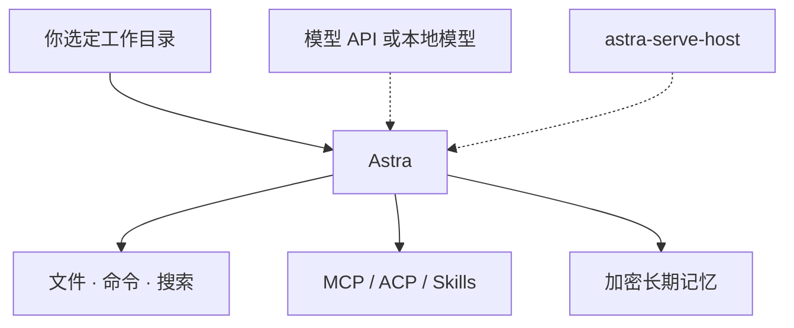

# ASTRA PRAXIS

```text
任务简报
座舱   你的电脑
航向   你指定的工作目录
原则   local-first · 密钥留舰

        ✦
     ·     ·
  ·     ☆     ·
     ·     ·
        ✦
```

[](https://github.com/astra-praxis/astra/releases)


Astra 是星，Praxis 是动手。星图画在你自己的硬盘上。

这是一个 **local-first AI Agent** 桌面应用。选一个工作目录，用对话让它读文件、改文件、跑命令、搜网页、写文档、出图。会话可以多开几扇标签；每次伸手碰工具，都先过权限引擎；记得住的东西加密后留在本机。模型走 OpenAI 兼容接口就行，本地服务也可以。脑子可以借，抽屉是自己的。

## 你大概是来找这些的

- **现在就用** — [下载 Astra](https://github.com/astra-praxis/astra/releases)。macOS / Windows / Linux 的安装包都在 Releases。装好后到设置里配一个模型服务，选个目录开始。
- **看驾驶舱** — [astra](https://github.com/astra-praxis/astra)。Tauri 2 桌面应用，Rust + React。能力、权限，以及还没做完的部分，仓库 README 写得很坦白。
- **桌面端要自动拉服务** — [astra-bot](https://github.com/astra-praxis/astra-bot)。这里只放 `astra-serve-host` 二进制，和给自动下载用的 [`latest.json`](https://github.com/astra-praxis/astra-bot/blob/main/latest.json)。源码不在这个仓库。
- **记忆要接到别的 Agent** — [astra-memory-mcp](https://github.com/astra-praxis/astra-memory-mcp)。独立的记忆 MCP：stdio、本地加密 SQLite，没有云，也没有遥测。Cursor、Claude Code、DeepSeek Harness 都能接。换模型，记忆还跟着你。

## 座舱里现在有的

- **工作区**：在你点名的目录里读、改、管理文件
- **工具**：文件、命令、网页搜索，再加上 MCP、ACP 和 Skills
- **会话**：多标签并行，历史能翻回来接着做
- **权限**：分级放权，越权硬拦截；工具吐出来的内容不会因此多得到任何权限
- **记忆**：跨会话沉淀，本地加密；记错了可以纠正，旧结论会失效
- **Artifact**：任务生成的文档和结果集中放
- **三端安装包**：macOS、Windows、Linux，从 Releases 走



runtime / core 还在灶上，公开航图里先不挂链接。能下载、能接上的，就是上面这三处。

## 起飞

1. 打开 **[astra Releases](https://github.com/astra-praxis/astra/releases)**，下载你这块系统的安装包。
2. 在设置里填一个 OpenAI 兼容的模型服务。
3. 选一个工作目录，把任务说清楚。

合用的话，给 [astra](https://github.com/astra-praxis/astra) 一颗 **Star**，或 **Watch** 它的 Releases。新安装包出来，你会先知道。

记忆要单独接：去 [astra-memory-mcp Releases](https://github.com/astra-praxis/astra-memory-mcp/releases) 拿对应平台的二进制。

---

桌面应用许可证是 [MIT](https://github.com/astra-praxis/astra/blob/main/LICENSE)。记忆组件的许可见它自己的仓库。`astra-serve-host` 二进制按现状分发。

有问题或想法，到对应仓库开 Issue。
